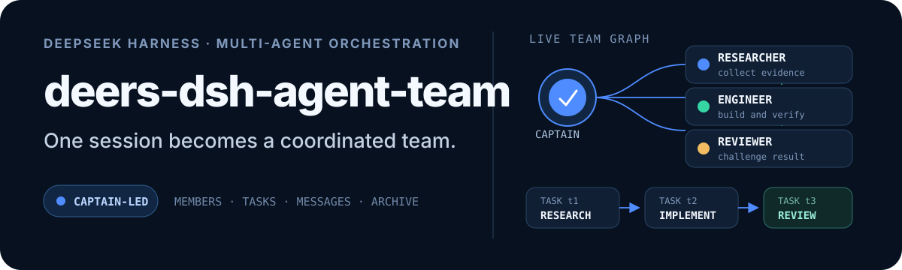
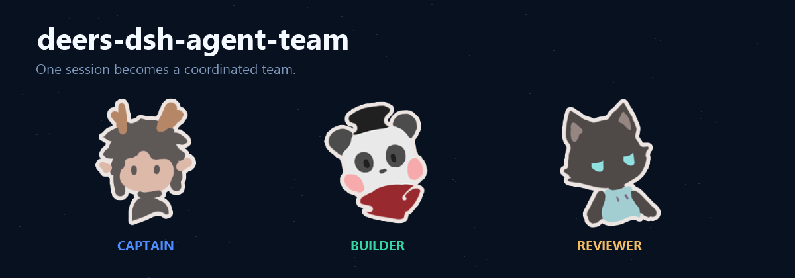

<p align="right">
  <strong>English</strong> · <a href="./README_ZH.md">简体中文</a>
</p>

<p align="center">
  
</p>

<p align="center">
  <a href="https://dshfind.com/en/plugins/NanmiCoder/deers-dsh-agent-team?ref=badge"></a>
  <a href="https://dshfind.com/en/plugins/NanmiCoder/deers-dsh-agent-team?ref=badge"></a>
  <a href="https://dshfind.com/en/plugins/NanmiCoder/deers-dsh-agent-team?ref=badge"></a>
</p>

<p align="center">
  <a href="https://www.npmjs.com/package/deers-dsh-agent-team"></a>
  <a href="./LICENSE"></a>
  <a href="./cordis.patch.yml"></a>
</p>

<p align="center"><a href="https://github.com/DeerLuuu/dsh-deer-team">github.com/DeerLuuu/dsh-deer-team</a></p>

## One prompt. A working team.

`deers-dsh-agent-team` turns the current DeepSeek Harness session into a captain that can assemble durable sub-agents, split a goal into dependency-aware tasks, and coordinate work through direct messages.

Ask in natural language. The plugin provides the team protocol, 29 coordination tools, persistent state, an automatic shared-task scheduler, and a live Web UI—without requiring a separate workflow engine.

<p align="center">
  
</p>

## Releases

[v0.1.30](./release-notes/v0.1.30.md) switches the compatibility policy to a **host line range**: the dsh peers declare the host line range (currently `0.2.x`) plus exact arms for known off-line/pre-release targets, so any later Harness `0.2.x` version (new alpha/beta/RC or patch) no longer needs a plugin sync at profile startup; only a line change (0.3, 0.4, …) does. Legacy `0.1.x` hosts stay enumerated exactly. This plugin release uses npm `latest`; the recommended host stays Harness `0.3.2-rc.2` (its `next` channel). [v0.1.29](./release-notes/v0.1.29.md) declared the `0.3.2-rc.2` preview RC host; [v0.1.28](./release-notes/v0.1.28.md) added the workspace panel's task operations, member mailbox, activity timeline, attempt history, state filter, multi-team switcher and DAG zoom/minimap. See the exact [support matrix](./compatibility.json).

## Why AgentTeams?

| Capability | What it changes |
| --- | --- |
| **Captain-led delegation** | The current session creates the team, assigns roles, and consolidates the final result. |
| **Durable members** | Members are continuable DSH sub-agents that can be woken for focused follow-up turns. |
| **Dependency-aware tasks** | Tasks move through explicit states and cannot be claimed before their dependencies finish. |
| **Automatic reuse and safe takeover** | Idle members claim the next ready task; reassignment revokes stale attempts before new work starts, and cold recovery retries stranded open attempts. |
| **Router-role captain** | The captain coordinates, reviews and consolidates; implementation/repair takeover is blocked by default (`captainMayImplement: false`) so heavy work stays with members unless a profile explicitly opts in. |
| **Direct messaging** | Members send durable mailbox messages directly to teammates or the captain—no relay required. |
| **Shared blackboard** | A durable team feed for brainstorming, idea collection and feature votes: every participant can post notes/ideas/proposals/decisions, read the whole board, and cast one up/down vote per proposal. The panel filters by author, kind and search text, groups by kind or member, shows per-kind counts, and can clean stale entries on demand. A configurable host loop removes entries older than the retention window while always keeping the newest N, pinned entries and decisions. Members can post and vote; clearing is captain-only. |
| **Team polls** | Formal voting lives in its own store: the captain starts a single- or multi-choice poll with explicit options, an adoption rule (`majority` / `gt` / `percent`), a quorum, an optional deadline and anonymity; every participant casts one revisioned ballot via `deers_team_vote_cast`, and closing freezes an auditable decision (adopted options, quorum status, summary). A dedicated poll floating window opens from the team header for the human; blackboard reactions stay informal. |
| **Independent watchdog** | A host-side loop raises alerts for stalled attempts, exhausted retries and message loops; alerts are persisted in team state, shown in status/digest, and wake the captain once per new alert. The watchdog reports, it never mutates task state. |
| **Bounded context** | `deers_team_digest` returns a length-bounded team summary for routine turns; `deers_team_recall` fetches exact task/message/board detail by id only when needed. |
| **Progress heartbeats** | Members report `deers_team_progress` (percent + note) during long steps without changing task status; the watchdog uses heartbeat age to tell working from stalled. |
| **Batched reports** | Member reports to an idle captain are coalesced within a short window (`routerBatchWindowMs`), so a burst wakes the Router once; a running captain still receives steers immediately. |
| **Deer dashboard** | The activity panel follows the DeerSuperGroup team layout: a phase topbar, a summary card with delivery ring and 进行中/排队中/等待依赖/已交付 counters, a members card that includes the captain, and a task star map with a starfield canvas, zoom/fit controls and the dependency graph. Wide workspace panes keep the resizable members / star-map split. |
| **Character artwork** | The whale set is replaced by three transparent cutout characters: the captain deer (stamping approvals), the builder panda (carrying the work box) and the reviewer cat (working through papers). Full illustrations, paper cutouts and compact stickers ship for the panel, conversation card and README. |
| **Live activity panel** | The Web UI combines segmented progress, a collapsible roster, and an interactive task DAG; running tasks show the member's model, and completed archives retain their full member and task history. |
| **Plan before execution** | Normal `/deers-agent-team` runs stage an unspawned roster and DAG first. The Web panel uses the host model catalog for member routes. Returning to chat stops the planning turn, asks what should change, and revises the same draft; discarding archives the draft, aborts the turn, and explicitly prevents automatic recreation. Only **Approve & Run** enables scheduling; each member starts with its first ready task. |
| **Quality gates** | Opt-in quality tasks support requirements → implementation → verification → review → integration contracts, automatic repair/re-review, and explicit resume. Scope control is a completion-time audit, not host write interception. See [docs/quality-gates.md](./docs/quality-gates.md). |

The conversation card and activity panel use Harness's official locale service. They follow live language changes between English and Simplified Chinese—including status labels, dynamic summaries, controls, archive markers, and accessibility text—without a page reload or a separate plugin setting.

## Install and choose versions

**Recommended pair: DeepSeek Harness `0.3.2-rc.2` + AgentTeams `0.6.0`. The host remains an RC.**

| Use case | DeepSeek Harness | AgentTeams plugin |
| --- | --- | --- |
| **Recommended** | **`0.3.2-rc.2`** | **`0.6.0`** |
| Preview RC (supported) | `0.3.2-rc.2` | `0.6.0` |
| Preview Alpha (supported) | `0.3.2-alpha.2` | `0.6.0` |
| Preview Alpha (supported) | `0.3.2-alpha.1` | `0.6.0` |
| Previous recommended RC | `0.1.7-rc.2` | `0.6.0` |
| Legacy RC | `0.1.5-rc.1`, `0.1.5-rc.2`, `0.1.5-rc.3` | `0.6.0` |
| Retaining an older RC | `0.1.2-rc.1` | `0.6.0` |
| Developer Alpha testing | `0.1.2-alpha.5` | `0.6.0` |
| Retaining an older Alpha | `0.1.2-alpha.2` | `0.6.0` |

### Desktop app

In the app sidebar, open **Plugins → Add plugin** and enter the npm package spec:

```text
deers-dsh-agent-team@0.6.0
```

Install it, then choose **Enable now**. If the host asks for a restart, restart the desktop app. Use the package spec above for the published build; an npm or GitHub webpage URL is not the same install source. For Git installation, use a commit containing the verified build outputs described below.

The desktop app supplies its own Harness core and package manager. Upgrading the global CLI does not upgrade that core, and an ordinary standalone CLI cannot manage its desktop profile. The CLI carrier installed by the desktop app can manage that profile in `0.3.2-rc.2`. Check the embedded core against the compatibility list. Harness `0.3.2-rc.2` is now the exact published target; its RC status is unchanged. Earlier source-only predictions are no longer support declarations. See the [release migration evidence](./docs/harness-0.3.2-rc.2/README.md).

### CLI / Web: 1. Install DeepSeek Harness

```sh
npm install --global @deepseek-ai/dsh@0.3.2-rc.2
dsh --version
```

Skip this if you already run this version. Alpha is opt-in: select an exact Alpha version from the table and lock all host dependencies as described in the [maintenance guide](./docs/maintenance-workflow.md).

### CLI / Web: 2. Install the AgentTeams plugin

Install or upgrade from npm (pinned to this `latest` release):

```sh
dsh plugin --profile web add --save-exact deers-dsh-agent-team@0.6.0
```

For a CLI-managed installation, replace `web` with your active CLI profile. **Stop and restart that profile's Harness process, then refresh the browser.** Installing the plugin does not upgrade Harness; the host and plugin have independent `latest` channels.

For Git installation, use a Git package spec pinned to a commit containing the verified server, client, and type build outputs in `lib/`, rather than an npm webpage URL. The repository distributes these outputs so installation does not need a `prepare` hook or build-script approval. Source maintainers must run `pnpm build` and update the committed outputs whenever the source changes. Existing npm releases remain immutable.

For a manually cloned checkout, run `pnpm install --frozen-lockfile` and `pnpm build` after pulling, then restart the corresponding Harness process. Updating Git alone does not update local build output. See the [maintenance guide](./docs/maintenance-workflow.md).

> For older `0.1.0-*` / `0.1.1-*` or unlisted hosts, keep a working pair and follow the [older-version and diagnostic guide](./docs/maintenance-workflow.md).

See the full [compatibility matrix](./compatibility.json), [source installation and Alpha testing guide](./docs/maintenance-workflow.md), and [verification coverage and platform limits](./docs/maintenance-2026-09-06/release/README.md).

Then ask for a team directly:

> Use AgentTeams to review the commits after v0.5.3 from performance, security, and product perspectives. Return one consolidated report.

## View teams in the workspace

Click **View team** in the current chat header or the team card below a reply to open the native **Team collaboration** tab. The entry belongs to its chat, rather than the general workspace start page.

Team and task content starts immediately: wide panes use columns and narrow panes stack them. Select a task to locate its owner; member icons open their conversations. Closing the tab does not stop the team, and its chat can reopen it. Completed teams retain their archives. Older hosts keep the activity panel.

## How it works

1. For a request to use AgentTeams, the captain follows the core protocol already in its system instructions. It continues an existing team and uses `deers_team_status` when current state needs checking. When no team exists, the goal becomes a staged plan for review.
2. The captain adds role-specific members backed by continuable sub-agents.
3. The goal becomes tasks with owners and explicit dependencies.
4. The shared scheduler uses real `running / idle / ready` state to atomically claim one ready task per idle member and wake it. An interrupted resident attempt stays parked and can resume through a direct message without losing its capability; after a cold process restart, the scheduler retries stranded open work with a fresh attempt.
5. Members update with the current `attempt_id`; reassignment or captain takeover revokes the old attempt and waits for the old worker to quiesce before a new attempt starts.
6. The captain presents the combined result, then archives the complete team record.

Team state is stored under `<workspace>/.deers-agent-team/`; the Web panel reads that disk truth and combines it with live sub-agent activity.

Member creation is zero-interaction by default: a member on the captain's current LLM route snapshots that provider, model, and reasoning effort, while a member on a requested alternative route snapshots the target model's default effort; later continuations restore the resolved snapshot. Only an explicit heterogeneous-team request (for example, “backend on provider A/model X, frontend on provider B/model Y”) supplies a member-specific `provider` + `model`; there is no per-member model or reasoning prompt.

Captain sessions keep the concise core protocol and all 29 native team tools from their first request. All business tools are directly available; no loading tool or extra activation call is needed. Configured profiles retain their bounded directory in the fixed system prompt. Creating, approving, continuing or ending a team does not rewrite the system prompt or tool schemas. Core rules remain available after history compaction or discarded code-mode tool results. Members receive four team tools, fixed member instructions, and their ordinary coding/research tools. Web approval wakes the captain with a control message; later member reports wake it again. See the [fixed protocol and benchmark contract](./docs/progressive-loading.md).

## Slash command

No “use AgentTeams” phrasing required. The plugin registers the
closed-namespace `/deers-agent-team` host command, so the Web GUI slash menu shows
an `deers-agent-team` placeholder with an input hint: pick it (or type the
command), describe the goal, and press Enter.

```
/deers-agent-team research the pricing pages of three competitors
```

The command pipeline claims the line, then preserves that exact input as an
ordinary user follow-up so it remains visible in the main chat. The gesture
boundary adds the deterministic activation directive at pre-step, so the
first model request follows the staged planning protocol without a mandatory helper call. The invocation is also durably
logged (`command/run` / `command/done`).

Surfaces without command adjudication (for example the headless CLI) get the
same deterministic activation through a gesture boundary: any genuine user
message starting with `/deers-agent-team` activates the protocol for the rest of
the text. Mid-sentence mentions stay ordinary prose.

Historical panels require saved team state or archives. Sessions from early versions that deleted teams without retaining archives do not yet support reconstructing the full panel from logs.

## Configuration

Defaults work without extra setup. A trusted profile can override member behavior:

```yaml
- id: deers-agent-team
  config:
    stateDir: .deers-agent-team
    memberProvider: spawn
    memberModel: deepseek-v4
    memberMaxDepth: 0
    maxMembers: 12
```

`memberMaxDepth` defaults to `0`: team members cannot create nested subagents. Set `1` to explicitly permit one descendant level; the limit also covers runtime/code-tool calls. Default members report through team messages only, avoiding duplicate native parent reports. Idle roster members make no model requests. Task assignments start distinct turns; coordination joins the nearest model step. Acceptance and consumption are tracked separately. Removal/archive drains the selected branch and its pending input before reporting success.

`memberProvider` is the sub-agent runtime backend (`spawn` / `fork`), not an LLM provider. Cross-LLM-provider routing uses the optional `provider` + `model` fields of `deers_team_add_member`; `memberModel` is only a model default for all members. A member on the captain's current provider/model inherits the captain's reasoning effort, while a changed provider or model automatically uses the target model's default. To request a particular effort, pass the optional `reasoning_effort` field — one of the target model's supported effort ids, or `"default"` to force the model's own default.

`slashCommand: false` disables the deterministic `/deers-agent-team` activation surfaces (slash command and gesture boundary), leaving the natural-language trigger as the only entry point.

## Boundaries

- One captain leads one active team at a time.
- Idle members with no open task are automatically reused for ready work. An idle member that still owns an open attempt is parked until messaged or explicitly reassigned; messages that cannot be delivered live remain durable and are retried at a later status boundary.
- State is file-backed and serialized within one DSH process; concurrent processes editing the same team are not coordinated.
- The activity panel reports persisted state as-is. Models may occasionally finish work without performing the expected task-state update.

See [docs/usage.md](./docs/usage.md) for the full tool reference, state model, Web UI behavior, configuration, and known limits.

## Plugin development Skill

Community upgrade, audit, benchmark, testing and release skills are vendored with a pinned source revision. See [skills/README.md](./skills/README.md) for local rules and [CONTRIBUTING.md](./CONTRIBUTING.md) for the contribution workflow.

The repository also ships the open Agent Skills package [`dsh-plugin-development`](./skills/dsh-plugin-development/SKILL.md):

```sh
npx skills add NanmiCoder/deers-dsh-agent-team --skill dsh-plugin-development
```

## Documentation

| Guide | Covers |
| --- | --- |
| [Usage](./docs/usage.md) | Architecture, UI behavior, tools, configuration, limits, and validation |
| [Verification](./docs/verification-guide.md) | Offline, composition, real e2e, and GUI verification |
| [Plugin development](./docs/developing-dsh-plugins.md) | Human-readable guide built from this plugin |
| [README writing](./docs/readme-writing-guide.md) | Repository documentation conventions |

## Development

```sh
pnpm install
pnpm build
pnpm verify
```

## Named multi-role profiles

Configure one or more complete team profiles in `cordis.patch.yml`. A profile always supplies the roster (independent provider/model/role/reasoning effort). Set `taskPlanning: captain` when the Captain should derive the DAG from the user's goal; omit it or set `taskPlanning: seed` to keep a fixed template workflow:

```yaml
profiles:
  demo-delivery:
    description: Ship a small feature
    protocol: Discuss requirements, review, test, then prepare release; do not deploy automatically.
    members:
      - name: analyst
        model: gpt-5.6-sol
        role: Analyze requirements
      - name: implementer
        model: gpt-5.6-terra
        role: Implement the approved solution
    tasks:
      - id: requirements
        subject: Requirements discussion
        assignee: analyst
      - id: implementation
        subject: Implement solution
        assignee: implementer
        dependencies: [requirements]
```

Use an explicit profile flag: `/deers-agent-team --profile demo-delivery implement the feature`. The first ordinary token is never treated as an implicit profile. Normal command runs call `deers_team_create({ profile, approval: "required" })`: the roster and seed/Captain-designed DAG remain staged, no child session is created, and no task is claimed. Edit the plan in the activity panel using the host model catalog, return to chat so the Captain asks what to revise and then atomically updates the same draft, discard it, or click **Approve & Run**. Return/discard actions cancel any planning turn still running; discard also parks model-facing context that forbids silently creating a replacement team. Approval resolves the final provider/model/reasoning choices, commits the roster, and creates each member session only when its first task is ready. A running team is stopped from its own panel header through a confirmation dialog rather than from the composer. Direct tool clients may pass `approval: "automatic"` for the legacy immediate path. Failed review/test tasks do not unlock downstream work; automatic repair/review tasks do not depend on the failed review.

## License

[MIT](./LICENSE)
